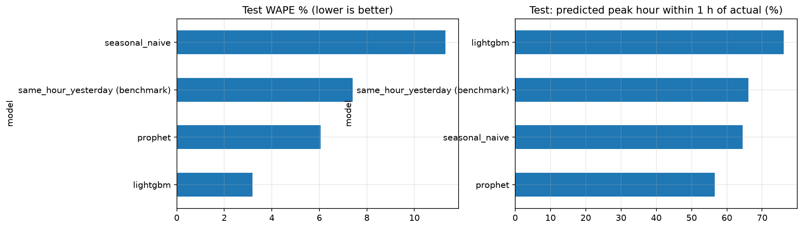
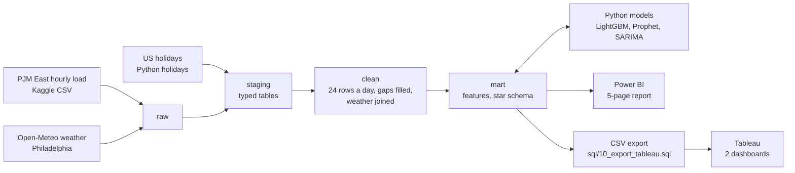
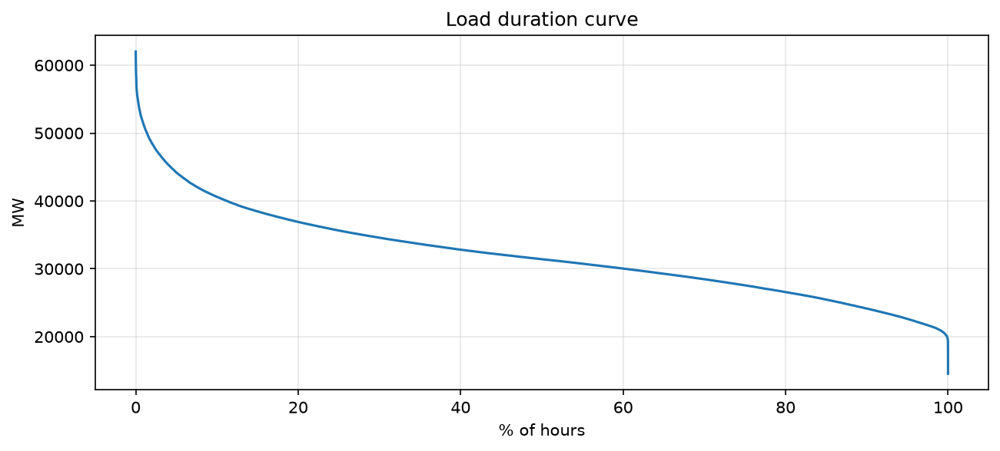
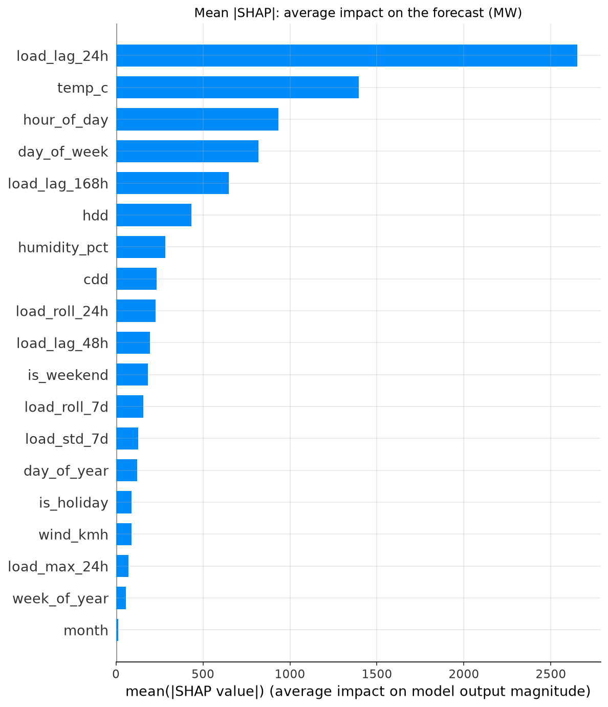
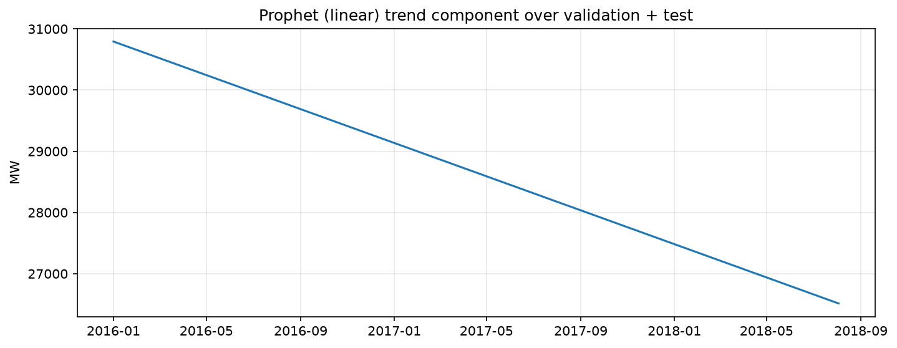
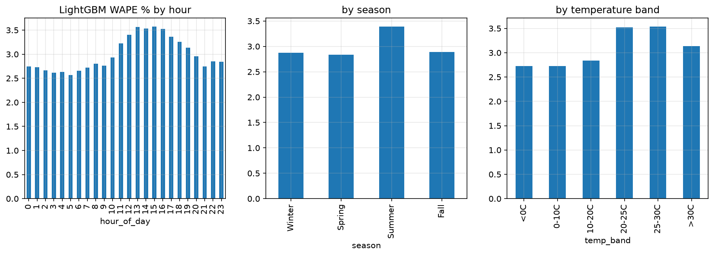
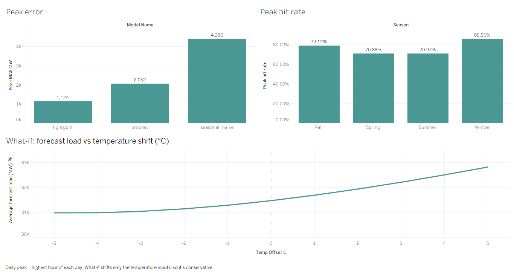
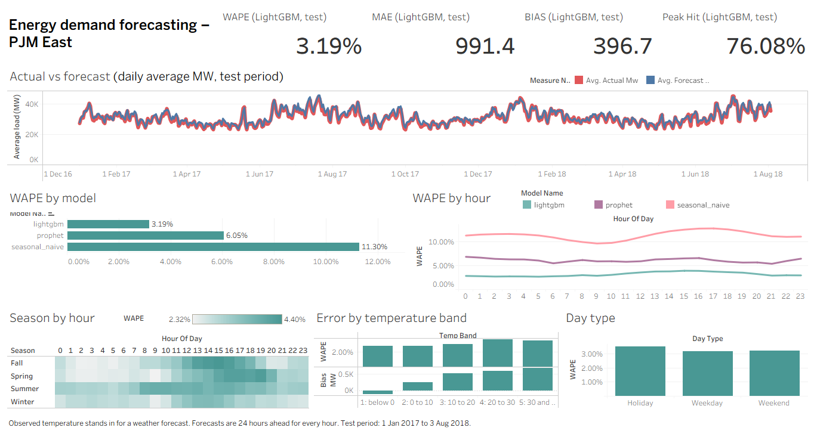
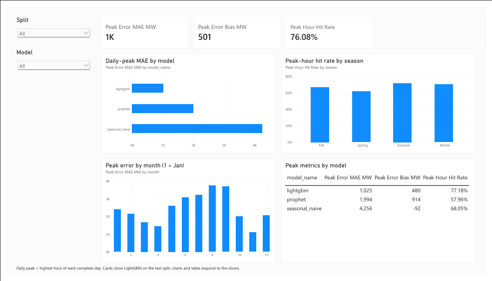
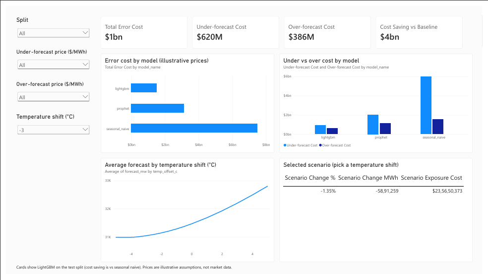

# Energy Demand Forecasting: PJM East

Hourly electricity demand forecasting for the PJM East region, built end to end with PostgreSQL,
Python, Power BI and Tableau.

## The problem

Electricity cannot be stored cheaply, so a grid operator or utility has to match supply to demand
every hour. Planners need to know, a day ahead, how much power will be used in each hour and how high
the daily peak will be. Demand depends on temperature, the hour of day, the day of the week and
holidays, so it is not easy to guess. A common shortcut is to assume that tomorrow will look like the
same hour one week ago. On this data that shortcut is wrong by about **11%** of total load.

**Main question:** how accurately can we forecast next-day hourly demand and the daily peak for PJM
East, and how much better is a proper model than the simple rule?

## The business problem it solves

A forecast error costs money in both directions:

- **Under-forecast (demand is higher than planned):** the shortfall must be covered by emergency
  purchases at high prices, and in the worst case supply is at risk.
- **Over-forecast (demand is lower than planned):** power is bought or held in reserve and then
  wasted.
- **Peak error:** the few hours around the daily peak decide how much capacity must be ready, so
  peak errors are the most expensive.

This project gives a procurement or operations planner three things: a next-day hourly forecast that
is far more accurate than the simple rule (WAPE 3.19% against 11.30%), a daily-peak forecast with an
error of about 1,100 MW instead of 4,400 MW, and a way to see what the remaining error costs and how
demand would change if temperature were higher or lower. The dollar figures use assumed prices
($150 per MWh short, $40 per MWh surplus), so they show how models compare and are not market data.

## Headline results

Test period: 1 Jan 2017 to 3 Aug 2018 (13,895 hours, 578 complete days). Models were chosen on a
separate validation year (2016), never on the test set.

| Model | WAPE (hourly) | Daily-peak error (MAE) | Peak hour within 1 h |
| --- | --- | --- | --- |
| **LightGBM** | **3.19%** | **1,126 MW** | **76.1%** |
| Prophet (flat trend) | 6.05% | 2,050 MW | 56.6% |
| Same hour yesterday (benchmark) | 7.40% | 2,618 MW | 66.1% |
| Seasonal naive, same hour last week (baseline) | 11.30% | 4,389 MW | 64.5% |

- LightGBM cuts WAPE by **71.8%** against the seasonal-naive baseline and by **56.9%** against the
  stronger same-hour-yesterday benchmark. It cuts daily-peak error by 74% against the baseline.
- SARIMA, which forecasts only the daily peak, scores a peak error of 2,221 MW.
- It is not a lucky split. In a six-fold expanding-window backtest (test years from Aug 2012 to
  Aug 2018), LightGBM's WAPE ranged from 2.64% to 3.13% (mean 2.83%) and beat both references in
  every fold (seasonal naive: mean 10.37%; yesterday: mean 7.01%).

WAPE is total absolute error divided by total actual load, so large-load hours count for more.
Figures are from `docs/results/model_comparison.csv` and `backtest_metrics.csv`.



## Architecture



Four schemas (`raw`, `staging`, `clean`, `mart`) are rebuilt from scratch by numbered SQL scripts.
The mart layer is the hub: models read features from it and write forecasts back, and both
dashboards read the same forecast numbers.

## How it was built, step by step

**Step 1: Collect the data.** Hourly PJM East load (Kaggle, 2002 to 2018) and hourly weather for
Philadelphia from the Open-Meteo archive (`src/download_weather.py`). US holidays come from the
Python `holidays` package.

**Step 2: Load and clean in SQL (PostgreSQL).** Four layers, each rebuilt from scratch by a numbered
script run through `run_pipeline.py`:
1. `01_schema`, `02_load_raw`: create the schemas and copy the CSV files untouched into `raw`.
2. `03_stage`: convert text to proper types in `staging` and keep a source file tag. Holidays are
   loaded by `src/load_holidays.py`.
3. `04_clean`: build exactly 24 rows per day. The 4 duplicated daylight-saving hours are averaged,
   the 30 missing hours are interpolated and flagged `is_imputed`, and spikes and dips are flagged
   (not deleted). Weather is joined on the hour.
4. `05_features`: create the model inputs with window functions: load 24, 48 and 168 hours earlier,
   rolling means, maximum and standard deviation that end 24 hours before the hour, calendar fields,
   holiday flag, temperature, humidity, wind, and heating and cooling degrees.
5. `06_star_schema`: build the dimensions (date, hour, model) and the fact tables (load, forecast,
   scenario forecast) used by the dashboards.
6. `07_checks`: 15 data-quality and leakage checks. The pipeline stops if one fails.

**Step 3: Explore the data** (`notebooks/01_eda`). Load shape by hour and season, the load duration
curve, temperature against load, and correlations with past load. This showed that peaks are rare,
hot, late-afternoon weekdays, and that yesterday predicts load better than last week.

**Step 4: Set the rules for a fair test.** Splits are time-ordered: train to 2015, validation 2016,
test 1 Jan 2017 to 3 Aug 2018. Every forecast uses only data at least 24 hours old. All tuning is done
on validation, and the test period is scored afterwards.

**Step 5: Baselines** (`02_baselines`). Seasonal naive (same hour last week) is the baseline, and
same hour yesterday is a stronger benchmark.

**Step 6: Models** (`03_models`, `04_lightgbm`, `05_sarima_backtest`).
- Prophet with calendar effects, holidays and temperature. A flat trend, chosen on validation, fixed
  a downward drift in the linear version.
- LightGBM on the SQL features, with an 8-setting grid searched on validation, early stopping, and a
  final refit on train plus validation.
- SARIMA on the daily peak only.
- A six-fold expanding-window backtest to confirm the result is stable.

**Step 7: Evaluate and explain** (`06_evaluation`). WAPE, MAPE, RMSE, MAE and bias; daily-peak error
and peak-hour timing; errors by hour, season, temperature band and day type; SHAP for the main
drivers; a temperature what-if (-5 to +5 °C); and a test of how much error in the temperature input
the model can tolerate.

**Step 8: Write forecasts back to the database.** Python writes forecasts and scenario forecasts to
`mart.fact_forecast` and `mart.fact_forecast_scenario`, so every report reads the same numbers.

**Step 9: Build the reports.** `09_powerbi_views` creates the views for Power BI (5 pages, star
schema, 37 DAX measures). `10_export_tableau` writes the CSV files for two Tableau dashboards.
Headline figures match across notebooks, Power BI and Tableau (3.19%, 991 MW, 397 MW, 76.08%).

**Step 10: Document.** Limitations, assumptions and a data dictionary are in `docs/`.

## How to reproduce

You need Windows, Python 3.10+, PostgreSQL (with `psql`), Power BI Desktop and Tableau.

1. Create a database called `energy_forecast` and copy `.env.example` to `.env` with your password.
2. Create the environment: `python -m venv .venv`, activate it, then `pip install -r requirements.txt`.
3. Get the data (not stored in this repository):
   - Download `PJME_hourly.csv` from the Kaggle dataset "Hourly Energy Consumption" into `data/`.
   - Run `python src/download_weather.py` to create `data/weather_philly.csv`.
4. Run the pipeline: `python run_pipeline.py`. It runs the SQL scripts in order, loads US holidays,
   and stops on the first failed check (15 data-quality and leakage checks).
5. Run the notebooks in `notebooks/` in order: `01_eda`, `02_baselines`, `03_models`,
   `04_lightgbm`, `05_sarima_backtest`, `06_evaluation`. They write forecasts to
   `mart.fact_forecast` and results to `docs/results/`.
6. Power BI: open `powerbi/energy_report.pbix` (Import mode from PostgreSQL; refresh after step 5).
7. Tableau: run `python run_pipeline.py --only 10` to write the CSVs in `tableau/`, then open
   `tableau/forecast.twbx`.

Note: re-running the full pipeline empties the forecast tables, so rerun notebooks 02 to 04
afterwards. Step numbers skip 08 on purpose: the Tableau export is `10`, because it reads views
created in `09`.

## Key findings

**1. Peaks are rare, hot, late-afternoon weekdays.** The all-time peak is 62,009 MW (2 Aug 2006,
17:00, 36.2 °C); only 0.16% of hours come within 10% of it, and the ten highest hours are all hot
weekdays between 2006 and 2011. About 80% of daily peaks fall between 17:00 and 21:00. The average
load is about 32,000 MW, so very few hours sit near the peak that capacity has to cover.



**2. Yesterday is a better predictor than last week.** Load correlates 0.89 with the load 24 hours
earlier but 0.78 with the load 168 hours earlier. That is why same-hour-yesterday (7.40% WAPE)
beats the weekly baseline (11.30%), and why I report both. Yesterday's load, temperature, hour of
day, day of week and last week's load are LightGBM's top SHAP drivers.



**3. Prophet's trend drifted, and a flat trend fixed it.** With a linear trend, Prophet
under-forecast by 3,297 MW on average on the test period (WAPE 11.22%, barely better than the
baseline). Forcing a flat trend, chosen on validation, cut WAPE to 6.05% and turned the bias to
+701 MW. Yearly average load is flat at about 31 to 33 GW, so a falling trend was an artefact.



**4. Where LightGBM is weakest.** Error is highest on summer days, fall afternoons (13:00 to
16:00) and spring evenings (16:00 to 19:00), and lowest overnight. Holidays are the hardest day
type. The model over-forecasts on average (+397 MW overall, +503 MW at the daily peak), and the
bias grows with temperature. Peak-hour timing is best in winter (85.9% within one hour) and weakest
in spring and summer (about 71%).



**5. What error costs, and what temperature does.** With assumed prices ($150 per MWh short,
$40 per MWh surplus), LightGBM's error on the test period costs about $1.0 billion against roughly
$5 billion for the baseline. Shifting temperature up 5 °C raises forecast load by about 1,340 MW
(+4.3%); shifting it down 5 °C lowers it by about 480 MW. See the Power BI pages.



## Model comparison

| Model | Test WAPE | Test RMSE (MW) | Test bias (MW) | Validation WAPE |
| --- | --- | --- | --- | --- |
| LightGBM | 3.19% | 1,294 | +397 | 2.75% |
| Prophet (flat trend) | 6.05% | 2,376 | +701 | 5.61% |
| Same hour yesterday | 7.40% | 3,134 | -15 | 6.65% |
| Seasonal naive | 11.30% | 4,794 | -67 | 10.60% |

**Why LightGBM won.** It sees recent load (24, 48 and 168 hours back plus rolling statistics) as
well as temperature and calendar effects, so it can correct yesterday's pattern for today's
weather. Prophet only sees calendar effects, holidays and temperature, never recent load, so it
misses the level and timing of day-to-day swings. LightGBM uses an L1 (absolute-error) objective,
31 leaves, `min_child_samples` 100 and 1,520 trees, tuned on the 2016 validation year. SARIMA
forecasts only the daily peak and cannot produce the hourly curve.

## Power BI and Tableau

- **Power BI** (`powerbi/energy_report.pbix`): Overview, Forecast vs Actual, Peak Load, Cost &
  Scenarios and an About page, on the star schema with 37 DAX measures. Screenshots are in
  `powerbi/screenshots/`.
- **Tableau** (`tableau/`): two dashboards, forecast accuracy and peak and what-if, built from the
  CSV exports. Build steps are in `docs/tableau_build_guide.md`.

Power BI and Tableau show the same forecasts. Small differences in the last digits can occur
(for example a daily-peak error of 1,124 MW in the dashboards against 1,126 MW in the notebooks)
because the daily-peak views keep only complete 24-hour days with no imputed hours.







The Power BI screenshots show the LightGBM test-split cards (see the page footers); the charts and
tables on those two pages were captured with the Split slicer on All, so their numbers include
validation and training hours.

## Assumptions and limitations

- **Observed temperature stands in for a weather forecast.** A real day-ahead system would use
  forecast temperature, so real accuracy would be lower. To size this, I added random noise to the
  temperature: WAPE rises from 3.19% to 3.52% (1 °C), 4.31% (2 °C) and 5.27% (3 °C), and the
  peak-hour hit rate falls from 76% to 54%. Even at 3 °C of noise, LightGBM still beats
  same-hour-yesterday (7.40%). Real forecast errors are correlated through the day, so this noise is
  harsher than reality, but it shows the model degrades gradually.
- **"24 hours ahead for every hour."** Each hour is forecast using only data at least 24 hours
  old. A forecast issued once at midnight for the whole next day could not use the same hour of
  yesterday for late-evening hours, so it would be somewhat less accurate.
- **The temperature what-if is conservative.** Only the temperature inputs move; the lag features
  still contain the real past weather. It also mixes seasons (warmth lowers winter heating demand
  and raises summer cooling demand), so the annual average understates summer sensitivity.
- **Cost prices are assumptions.** $150 per MWh for emergency purchases and $40 per MWh for wasted
  procurement are illustrative, not market data. Use the price slicers in Power BI to test others.
- **LightGBM over-forecasts** by about 400 MW on average. I did not investigate the cause (a
  slowly falling load trend is one candidate).
- **One weather station.** Philadelphia stands in for the whole PJM East region.
- **Data cleaning.** The raw file has 145,366 hourly rows, with 4 duplicated daylight-saving
  hours (averaged) and 30 missing hours (linearly interpolated, flagged `is_imputed`). Imputed
  hours and days containing them are excluded from every metric. Outliers are flagged, not removed.
- **Partial years.** 2002 and 2018 are partial years, so yearly totals for those years are not
  comparable with the rest.

More detail is in `docs/assumptions.md`; column definitions are in `docs/data_dictionary.md`.

## What I would do next

1. Replace observed temperature with historical day-ahead weather forecasts.
2. Add prediction intervals (quantile LightGBM) so the cost view can show risk, not only a point
   forecast.
3. Add a second weather station and a weighted regional temperature.
4. Look into the +400 MW over-forecast bias and the holiday errors, for example with a holiday-aware
   feature set or a bias-correction step.
5. Forecast once a day at a fixed time (true day-ahead) and measure the accuracy cost.

## Repository structure

```text
energy-demand-forecasting/
  README.md
  run_pipeline.py     runs the SQL scripts and checks in order
  requirements.txt
  data/               raw files (git-ignored)
  sql/                01_schema ... 07_checks, 09_powerbi_views, 10_export_tableau
  src/                config, db, features, train, evaluate, write_forecasts, loaders
  notebooks/          01_eda, 02_baselines, 03_models, 04_lightgbm, 05_sarima_backtest, 06_evaluation
  powerbi/            energy_report.pbix, measures.dax, theme, screenshots
  tableau/            CSV exports, dashboards, screenshots
  docs/               data_dictionary, assumptions, build guides, figures, results
```
